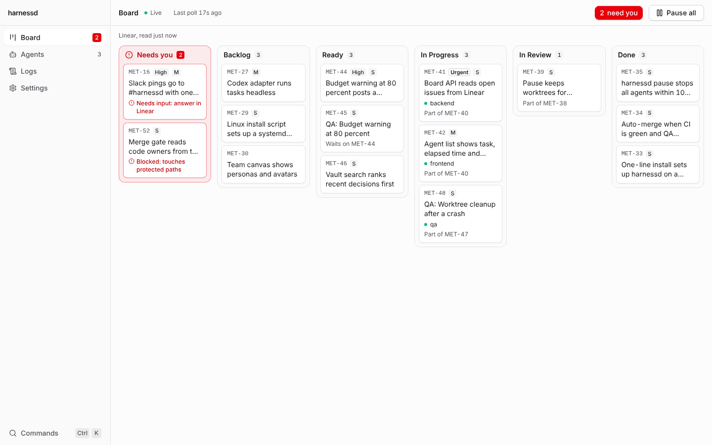
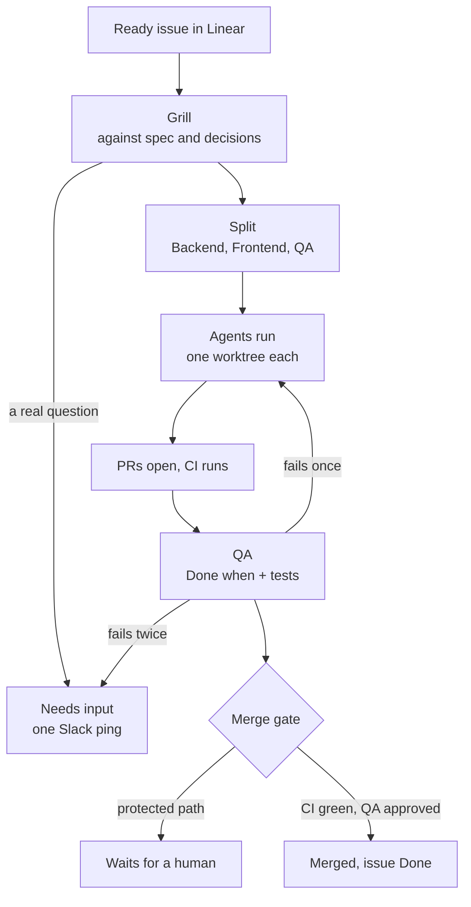
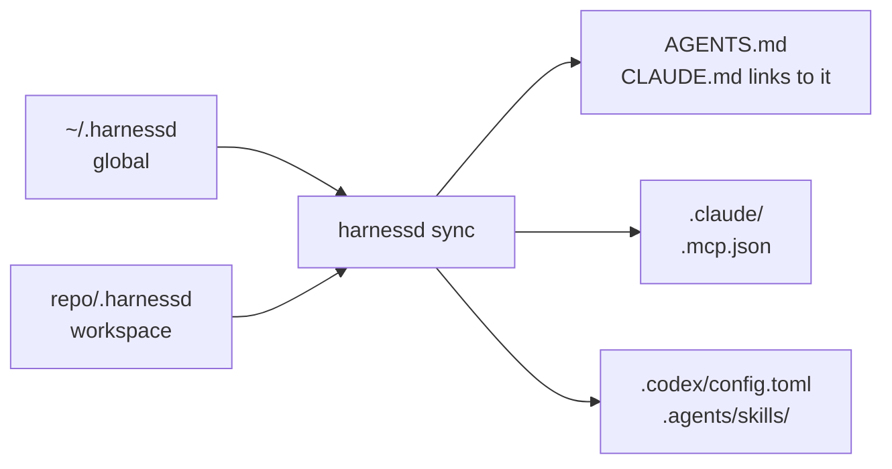

<p align="center">
  <picture>
    <source media="(prefers-color-scheme: dark)" srcset="assets/brand/lockup-dark.svg">
    
  </picture>
</p>

<h3 align="center">One harness to rule them all.</h3>

<p align="center">
  A local daemon that runs an autonomous engineering team on the coding-agent CLIs you already pay for.<br>
  For developers who want Ready issues turned into merged PRs while they do something else.
</p>

<p align="center">
  <a href="LICENSE"></a>
  <a href="https://github.com/ashwinYardi/harnessd/actions/workflows/ci.yml"></a>
  
</p>

<p align="center">
  <picture>
    <source media="(prefers-color-scheme: dark)" srcset="assets/readme/board-dark.png">
    
  </picture>
  <br><sub>The board, with demo data.</sub>
</p>

> [!NOTE]
> harnessd is pre-release (v0.1 beta). It runs on macOS first. `@harnessd/cli` is not on npm yet, so for now [build it from source](#install).

## What you get
- **A team, not a chatbot.** A coordinator plus Backend, Frontend and QA agents work through your Linear board without you.
- **Grilled issues.** Before any code, the coordinator checks each issue against your spec, decisions and glossary, and answers its own questions.
- **Clean isolation.** Every task runs in its own git worktree and branch.
- **Real QA, then a gate.** QA checks each PR against the issue's "Done when" list. Only approved, green PRs merge. See [Safety](#safety).
- **One config.** `~/.harnessd` and `<repo>/.harnessd` generate each harness's native files with `harnessd sync`.
- **A live board.** A local web UI shows issues, agents, budgets and logs, holds the pause button, and sets up harnesses, connections and the team in a few clicks.
- **Your subscriptions.** harnessd drives each harness through its CLI. You keep your own plan and sign-in. No vendor SDK and no model API key.
- **Memory and skills.** Markdown vaults reach Claude Code and Codex over a built-in MCP server. `init` installs a skill pack for TDD, code review, design and more.
- **Slack, quietly.** One line per merge or block, and one summary a day.

## How it works
One Ready issue, end to end:



One config, every harness:



Settings, rules, skills, agents and MCP servers merge in order: defaults, global, workspace, then the agent. Generated files are never edited by hand. Details: [docs/SYNC.md](docs/SYNC.md).

## Supported harnesses
| Harness | v0.1 | What works |
|---|---|---|
| Claude Code | **Shipped** | Runs every agent by default. `init` installs it, `doctor` checks it, `sync` writes its files. |
| Codex | **Detected** | `init` installs it. Settings shows its CLI and sign-in, and `doctor` checks it once an agent uses it. `sync` writes its files. Running agents on it is planned. |
| Antigravity, OpenCode, Cursor, Grok | Planned | Accepted as names in config. No adapter yet. |

## Install
You need macOS (or Linux, without the background service), Node 24 or newer, the `gh` CLI signed in to GitHub, and a Linear API key.

Until `@harnessd/cli` is on npm, build it from source with pnpm 10, and put a `harnessd` command on your PATH. Run the block with Node 24 active, for example `nvm use 24`. The wrapper names that Node by its full path, so the launchd service runs it too:

```bash
node -e 'process.exit(+process.versions.node.split(".")[0] < 24 ? 1 : 0)' || { echo 'harnessd needs Node 24 or newer'; exit 1; }
git clone https://github.com/ashwinYardi/harnessd.git && cd harnessd
corepack enable && pnpm install && pnpm build
mkdir -p ~/.local/bin
printf '#!/bin/sh\nexec "%s" "%s/packages/cli/dist/bin.js" "$@"\n' "$(command -v node)" "$PWD" > ~/.local/bin/harnessd
chmod +x ~/.local/bin/harnessd   # ~/.local/bin must be on your PATH
```

Once the package is on npm, one line will do it. It installs Node 24 if needed, then runs `harnessd init`:

```bash
curl -fsSL https://raw.githubusercontent.com/ashwinYardi/harnessd/main/scripts/install.sh | sh
```

Flags, paths, the service and uninstall: [docs/INSTALL.md](docs/INSTALL.md).

## Quick start
1. **Set up.** In the repo you want the team to work on:

   ```bash
   harnessd init
   ```

   It finds or installs the Claude Code and Codex CLIs, writes `~/.harnessd/config.toml`, installs the skill pack and, on macOS, loads the background service. It asks before it installs anything.

2. **Point it at Linear.** Add your team to `.harnessd/config.toml` in the repo:

   ```toml
   [linear]
   team_id = "ENG"
   ```

3. **Check everything.**

   ```bash
   harnessd doctor
   ```

   One row per check: Node, config, each harness, GitHub, Linear, Slack, worktrees, the port and the skill pack. Each failure prints its fix.

4. **Run.**

   ```bash
   harnessd run
   ```

   Paste your Linear API key in Settings, Connections. No shell edit is needed ([docs/INSTALL.md](docs/INSTALL.md#secrets)).

   The background service can run it for you instead: [docs/INSTALL.md](docs/INSTALL.md#the-launchd-service).

5. **Open the app** at [http://127.0.0.1:4747](http://127.0.0.1:4747). If anything still blocks, it opens Settings:
   - **Harnesses:** install, update or sign in to each CLI.
   - **Connections:** each GitHub, Linear and Slack check, with its fix. Paste the Linear key and the Slack webhook here.
   - **Team:** the role, harness and model of each agent.

   When nothing blocks, press **Start**. Then move an issue to Ready in Linear and watch the board.

## Your team
| Agent | What it does |
|---|---|
| **Coordinator** | Always on. Picks the highest-priority Ready issue, grills it against the spec and decisions, records each call, and asks you only when it must. Splits the issue into Backend and Frontend parts plus a QA part, then assigns them. |
| **Backend** | Takes the server, API and data parts. Works in its own worktree, pushes a branch and opens a PR. |
| **Frontend** | Takes the UI parts. Impeccable, from the skill pack, is there for design work: states, keyboard use, focus and contrast. |
| **QA** | Runs your test command at each PR head, checks every "Done when" item with evidence, and approves or requests changes. |

Every agent runs on Claude Code by default. Each one can have its own model and instructions in `.harnessd/agents/<name>.md`.

## Safety
- **Merge gate.** A PR merges only when QA approved its current head, CI is green and no protected path changed. Protected by default: auth, payments, secrets, release config and the merge-gate config itself. A PR that touches one gets a `needs-human` label and waits for you.
- **Budgets.** Small tasks get 30 minutes and medium tasks 2 hours. Large tasks are never run: they must be split. At most 3 agents run at once.
- **Kill switch.** `harnessd pause`, or the button in the UI, stops every agent within 10 seconds. Worktrees are kept. No merge happens while paused, and a pause survives a restart.
- **Escalation.** When a question is worth your time, after two QA or gate failures, or when a run fails twice, the issue moves to **Needs input** and you get one Slack ping. The loop moves on to the next issue.
- **Local only.** The API and UI listen on `127.0.0.1`. harnessd never stores a GitHub token or a Slack webhook on disk.

## Configuration
All of it is optional. One file per layer:

```toml
[limits]
max_concurrent = 3
budget_minutes = { S = 30, M = 120 }

[agents.backend]
harness = "claude-code"
model = "opus"

[merge]
method = "squash"
```

Every key, the merge rules and the agent files: [docs/CONFIG.md](docs/CONFIG.md).

## Roadmap
**v0.1** (now, in beta): the coordinator and three agents, Linear, worktrees, QA, the merge gate, budgets and pause, `init`, `doctor` and `sync`, Slack, memory vaults, the skill pack and the web UI, on Claude Code.

**v0.2** (planned):
- **Junior and senior lanes.** Each task gets a cheap or strong model by size and risk, and moves up a lane after a QA failure.
- **Any task tool.** GitHub Issues next, then others through one interface.
- **Local markdown tasks.** No task tool needed: one file per task in `.harnessd/tasks/`.
- **More harnesses.** Codex runs agents, then Antigravity, OpenCode, Cursor and Grok.
- **A team canvas** with personas and avatars, and sandboxed or cloud runtimes.

## Docs
| Doc | What is in it |
|---|---|
| [SPEC.md](docs/SPEC.md) | What v0.1 is and is not |
| [INSTALL.md](docs/INSTALL.md) | Install, `init`, `doctor`, the service, Slack, uninstall |
| [LOOP.md](docs/LOOP.md) | The autonomy loop: split, dispatch, pause, QA, merge |
| [COORDINATOR.md](docs/COORDINATOR.md) | How the coordinator grills an issue |
| [CONFIG.md](docs/CONFIG.md) | Every config key and the merge rules |
| [SYNC.md](docs/SYNC.md) | The files `harnessd sync` writes |
| [MEMORY.md](docs/MEMORY.md) | The vaults and the memory MCP server |
| [API.md](docs/API.md) | The local HTTP API |
| [decisions/](docs/decisions) | Every design decision, with its reason |

## Contributing
The goal of v0.1.0 is that harnessd builds itself: its own agents take its Linear issues. People are welcome too. Read [CONTRIBUTING.md](CONTRIBUTING.md), then:

```bash
pnpm i && pnpm build && pnpm test
```

## License
[MIT](LICENSE). The brand files in [assets/brand](assets/brand) come with their own [rules](assets/brand/README.md).

## Credits
- Engineering skills from [mattpocock/skills](https://github.com/mattpocock/skills), MIT.
- The Impeccable design skill from [pbakaus/impeccable](https://github.com/pbakaus/impeccable), Apache 2.0.
- The wordmark is drawn from Inter, SIL Open Font License 1.1.
- Third-party UI code and its licences: [packages/ui/THIRD_PARTY_NOTICES.md](packages/ui/THIRD_PARTY_NOTICES.md).
